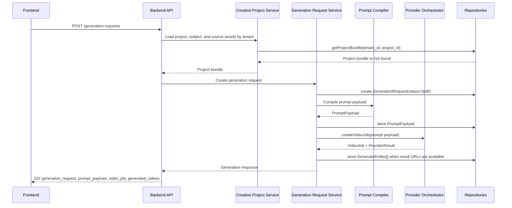

# Kastonom Backend System Plan

## Purpose

The Kastonom backend is the orchestration layer for the hackathon MVP. It exposes stable APIs to the frontend, enforces tenant boundaries, stores user-provided creative inputs and source assets, compiles provider prompt payloads, creates video jobs, calls provider adapters, stores generated video variants, handles explicit ad publication requests, stores ad metrics snapshots, and keeps a deterministic demo replay path available.

The latest data model is `docs/contracts/data-model.contract.yaml` version `0.2.0`. Backend implementation must follow that model. The old ERP product recommendation, commerce scoring, product metrics, inferred audience segmentation, and `Campaign`/`CreativeBrief` model language are deprecated for new backend work.

The backend should make the demo feel complete without pretending the MVP is production infrastructure. The implementation should be boring, explicit, and easy to debug under hackathon pressure.

## Non-Negotiable Rules

- Frontend never calls AI video providers.
- Frontend never calls ad platform publishing APIs directly.
- Frontend never generates final video prompts.
- Backend never bypasses tenant scope.
- Backend never calls a live video provider unless provider configuration is complete and mode allows live calls.
- Backend never publishes ads unless the user explicitly asks and ad platform configuration is complete.
- Backend never fabricates subject facts, prices, discounts, stock, guarantees, audience demographics, provider state, publication state, or platform metrics.
- Missing required configuration fails closed.
- Mock fallback is allowed only when configured and must be labeled as mock.
- Provider and ad platform secrets come from environment variables or secure connector storage only.
- Logs, fixtures, tests, provider results, publication results, and error responses must not include secrets.
- All AI, provider, and ad platform outputs are normalized before the frontend receives them.

## Recommended MVP Backend Shape

The repository currently contains documentation only. The implementation task may choose the final runtime, but this plan recommends a simple TypeScript backend because it gives strong contracts, easy JSON validation, and fast hackathon iteration.

Recommended stack:

- Runtime: Node.js with TypeScript.
- HTTP layer: Fastify or Express.
- Validation: Zod, Valibot, TypeBox, or a small local validator if dependency minimization is preferred.
- Tests: Vitest or Node test runner.
- Persistence for MVP: in-memory repositories seeded from JSON fixtures.
- Persistence upgrade path: SQLite or Postgres behind the same repository interfaces.

If a future scaffold chooses a different backend runtime, preserve the module boundaries and behavior in this plan.

## Backend Component Map

```text
Frontend
  -> HTTP API
    -> request context and tenant guard
      -> creative project service
      -> generation request service
        -> prompt compiler service
        -> provider orchestration service
          -> video provider adapters
        -> video job service
        -> generated video service
      -> ad publication service
        -> ad platform adapters
      -> metrics service
      -> iteration suggestion service
      -> demo replay service
      -> repositories
```

Backend modules:

- `server`: starts the process and binds HTTP routes.
- `app`: constructs the HTTP app without listening, for tests.
- `config`: reads environment variables, validates mode, and exposes safe configuration readiness.
- `request-context`: resolves tenant id, request id, mode, and fallback eligibility.
- `errors`: maps domain errors into stable API responses.
- `repositories`: stores the entities defined by the data model contract.
- `fixtures`: deterministic demo data and mock provider output.
- `creative-project.service`: creates and reads creative projects, subjects, and source assets.
- `generation-request.service`: validates generation settings and coordinates generation workflow.
- `prompt-compiler.service`: compiles backend-owned input bundles into normalized `PromptPayload` records.
- `provider-orchestrator.service`: selects video provider, checks config, applies fallback policy, and stores results.
- `provider-adapters`: `mock`, `pollo`, `kling`, `runway`.
- `video-job.service`: owns status transitions and polling responses.
- `generated-video.service`: lists and selects generated video variants.
- `ad-publication.service`: handles explicit publication requests and normalized publication state.
- `ad-platform-adapters`: `mock`, `meta_ads`, `google_ads`.
- `metrics.service`: stores metrics snapshots without inventing values.
- `iteration-suggestion.service`: stores externally supplied or fixture-provided iteration suggestions; it does not generate MCP/AI content.
- `demo-replay.service`: returns deterministic demo state for `/demo/fallback`.

MCP ownership boundary:

- MCP is owned by a separate teammate/workstream.
- Backend tasks must not create `backend/src/mcp/**`, MCP services, MCP mocks, AI validators, model prompts, product scoring, audience inference, or metric-informed suggestion generation.
- A later explicit integration contract may define how backend consumes an externally implemented MCP service.

## Suggested File Layout

This is a planning target, not a required current file tree.

```text
backend/
  package.json
  tsconfig.json
  src/
    app.ts
    server.ts
    config/
      env.ts
      modes.ts
    http/
      routes/
        health.route.ts
        creative-projects.route.ts
        generation-requests.route.ts
        video-jobs.route.ts
        generated-videos.route.ts
        ad-publications.route.ts
        creative-iteration-suggestions.route.ts
        demo.route.ts
      middleware/
        request-context.ts
        tenant-guard.ts
      errors/
        api-error.ts
        error-mapper.ts
    domain/
      ids.ts
      clock.ts
      types.ts
      validation.ts
    repositories/
      repository.types.ts
      memory-store.ts
      tenant.repository.ts
      creative-project.repository.ts
      creative-subject.repository.ts
      source-asset.repository.ts
      generation-request.repository.ts
      prompt-payload.repository.ts
      video-job.repository.ts
      provider-result.repository.ts
      generated-video.repository.ts
      ad-platform-connection.repository.ts
      ad-publication.repository.ts
      ad-metrics-snapshot.repository.ts
      creative-iteration-suggestion.repository.ts
    creative-projects/
      creative-project.service.ts
      creative-project.schemas.ts
    generation-requests/
      generation-request.service.ts
      generation-request.schemas.ts
    prompt-compiler/
      prompt-compiler.service.ts
      prompt-payload.schemas.ts
    providers/
      provider.types.ts
      provider-orchestrator.service.ts
      adapters/
        mock-provider.adapter.ts
        pollo.adapter.ts
        kling.adapter.ts
        runway.adapter.ts
    video-jobs/
      video-job.service.ts
      video-job.schemas.ts
    generated-videos/
      generated-video.service.ts
      generated-video.schemas.ts
    ad-publications/
      ad-publication.service.ts
      ad-publication.schemas.ts
      ad-platform.types.ts
      adapters/
        mock-ad-platform.adapter.ts
        meta-ads.adapter.ts
        google-ads.adapter.ts
    metrics/
      metrics.service.ts
      metrics.schemas.ts
    iteration-suggestions/
      iteration-suggestion.service.ts
      iteration-suggestion.schemas.ts
    demo/
      demo-replay.service.ts
      demo-fixture.loader.ts
  fixtures/
    demo-tenant.json
    demo-creative-project.json
    demo-creative-subject.json
    demo-source-assets.json
    demo-generation-request.json
    demo-prompt-payload.json
    demo-video-job.json
    demo-provider-result.json
    demo-generated-videos.json
    demo-ad-platform-connections.json
    demo-ad-publication.json
    demo-ad-metrics-snapshot.json
    demo-creative-iteration-suggestion.json
  tests/
    contract/
    unit/
    integration/
```

## Runtime Modes

The backend should make mode decisions explicit.

### `mock`

Default local and demo mode.

- Creative data source: demo fixtures or request-provided data stored in memory.
- Prompt compiler: real local compiler if implemented, otherwise deterministic mock compiler.
- Video provider: mock provider.
- Ad platform provider: mock adapter only.
- External network calls: none.
- Missing live credentials: irrelevant because live providers are not selected.

### `live`

Live provider mode.

- Creative project data may still be stored locally for MVP unless a later task adds durable persistence.
- Video provider calls are allowed only when selected provider config is complete.
- Ad publication calls are allowed only when selected platform config and connection readiness are complete.
- Missing provider credentials fail closed with provider-specific configuration errors.
- Mock fallback is used only if `KASTONOM_FALLBACK_ENABLED=true` and the request or environment allows fallback.

### `degraded`

Response state, not necessarily a startup mode.

- Used by `/health` when optional dependencies are unavailable.
- Core API can still serve mock or stored demo data.
- Must not imply live video provider or ad platform readiness.

## Environment Configuration

Suggested environment variables:

```text
KASTONOM_MODE=mock | live
KASTONOM_FALLBACK_ENABLED=true | false
KASTONOM_DEMO_TENANT_ID=demo-tenant
KASTONOM_DEFAULT_VIDEO_PROVIDER=mock | pollo | kling | runway
KASTONOM_DEFAULT_LANGUAGE=Turkish
KASTONOM_DEFAULT_PLATFORM=generic_vertical | tiktok | reels | youtube_shorts | meta_ads | google_ads
KASTONOM_DEFAULT_DURATION_SECONDS=15
KASTONOM_DEFAULT_ASPECT_RATIO=9:16
KASTONOM_PUBLIC_BASE_URL=http://localhost:3000
KASTONOM_MOCK_PREVIEW_URL=/demo-assets/mock-ad-preview.mp4

POLLO_API_KEY=...
POLLO_API_BASE_URL=...
KLING_API_KEY=...
KLING_API_BASE_URL=...
RUNWAY_API_KEY=...
RUNWAY_API_BASE_URL=...

META_ADS_ACCOUNT_ID=...
GOOGLE_ADS_ACCOUNT_ID=...
```

Configuration rules:

- Parse and validate config at startup.
- Do not crash on missing live provider credentials in `mock` mode.
- In `live` mode, do not call video provider adapters until provider-specific config is validated.
- In `live` mode, do not call ad platform adapters until platform-specific config and connection readiness are validated.
- Treat empty strings as missing config.
- Never return config values or secrets through API responses.
- Surface safe readiness through `/health`.

## Request Context and Tenant Scope

Every tenant-scoped endpoint resolves a request context before touching data.

Request context fields:

- `request_id`: generated per request for logs and errors.
- `tenant_id`: from `x-tenant-id`, or fixed demo tenant in demo mode.
- `mode`: resolved backend mode.
- `fallback_enabled`: resolved fallback policy.
- `requested_video_provider`: provider from request body or default provider.
- `is_demo_tenant`: true only for the configured demo tenant.

Rules:

- `GET /health` does not require tenant scope.
- `GET /demo/fallback` may use the fixed demo tenant only.
- Creative project, generation request, video job, generated video, ad publication, metrics, and iteration suggestion endpoints require tenant scope.
- If demo mode supplies a default tenant, API responses should still include data scoped to that tenant.
- Unknown tenant returns `INVALID_TENANT`.
- Missing tenant outside demo mode returns `INVALID_TENANT` or `UNAUTHORIZED`, depending on auth design chosen later.
- Data repositories always receive `tenant_id`.
- Repository methods must prefer compound lookups like `(tenant_id, id)`.

## Data Model Notes

The current `docs/contracts/data-model.contract.yaml` is the source of truth.

Minimum backend entities for MVP:

- `Tenant`
- `CreativeProject`
- `CreativeSubject`
- `SourceAsset`
- `GenerationRequest`
- `PromptPayload`
- `VideoJob`
- `ProviderResult`
- `GeneratedVideo`
- `AdPlatformConnection`
- `AdPublication`
- `AdMetricsSnapshot`
- `CreativeIterationSuggestion`

Deprecated entities must not be used for new backend implementation:

- `Product`
- `ProductMetric`
- `AudienceSegment`
- `Campaign`
- `CreativeBrief`

Recommended shared fields:

- `source`: use the enum values from each entity contract.
- `fallback_reason` or `fallback_notes`: string or string array where defined.
- `created_at`, `updated_at`.
- `metadata` or `redacted_metadata`: object for adapter-specific or demo metadata.

Use `unknown`, `not_available`, `null`, absent optional fields, or explicit fallback notes when facts are missing.

## Creative Project and Asset Flow

`POST /creative-projects` creates the initial project bundle.

Inputs:

- Tenant context.
- Project name.
- Creative subject facts.
- One or more source asset references.

Outputs:

- `creative_project`
- `creative_subject`
- `source_assets`
- `fallback_reason`

Rules:

- Subject facts must come from user input, explicit import, mock fixture, or unknown source markers.
- Missing optional facts must be represented through `unknown_fields`.
- External URLs are references, not proof of unavailable claims.
- Mock assets must be marked with `source=mock`.

## Generation Request Flow

`POST /generation-requests` is the central video generation orchestration endpoint.

High-level sequence:



Endpoint rules:

1. Resolve request context.
2. Validate tenant.
3. Validate `project_id`, `source_asset_ids`, provider, platform, duration, aspect ratio, language, and user creative settings.
4. Load tenant-scoped project bundle.
5. If project or selected assets are missing, return a stable not-found or validation error.
6. Create `GenerationRequest` with deterministic status transitions.
7. Compile `PromptPayload` from subject, assets, and request settings.
8. Store prompt payload.
9. Ask provider orchestrator to create video job.
10. Store video job, provider result, generated videos, errors, and fallback state.
13. Return 202 with generated artifacts.

## Prompt Compilation

The backend calls the prompt compiler after input validation.

Rules:

- The prompt compiler does not recommend products.
- The prompt compiler does not infer audience demographics.
- The prompt compiler does not call providers.
- The prompt compiler uses only `CreativeSubject`, `SourceAsset`, and `GenerationRequest` fields plus explicit fallback notes.
- Provider-specific options stay under `provider_options` or an equivalent metadata field.
- Prompt payloads must be stored with `generation_request_id`.

## Provider Orchestration

Provider orchestrator responsibilities:

- Accept `PromptPayload`.
- Check selected provider support.
- Validate provider credentials for live provider.
- Call provider adapter.
- Normalize provider response into `ProviderResult`.
- Create or update `VideoJob`.
- Create `GeneratedVideo` rows when output URLs are available.
- Apply mock fallback only when allowed and label it.

Provider adapter interface should return:

- `provider`
- `provider_job_id`
- `normalized_status`
- `result_urls`
- `error_code`
- `error_message`
- `redacted_metadata`
- `received_at`

## Video Job Polling

`GET /video-jobs/{id}` returns tenant-scoped video job state.

Response should include:

- `video_job`
- `provider_result`
- `generated_videos`
- `fallback_reason`

Rules:

- Never reveal jobs outside tenant scope.
- Use stored normalized provider result for MVP polling.
- Mock jobs may complete immediately or progress deterministically across polls, but the behavior must be documented by the implementation task.
- Failed jobs must include normalized error fields when available.

## Generated Video Selection

`POST /generated-videos/{id}/select` marks one generated video as selected.

Rules:

- The generated video must belong to the requesting tenant.
- The generated video must belong to the project being updated.
- The service updates `CreativeProject.selected_generated_video_id`.
- A project should have at most one selected generated video unless a later multi-select contract adds support.
- Mock videos remain visibly mock after selection.

## Ad Publication

`POST /ad-publications` tracks the user's explicit decision to publish a selected generated video.

Rules:

- Publication requires explicit user action.
- The selected generated video must belong to the tenant.
- Backend must validate the ad platform connection and required configuration before any live call.
- In mock mode, use a deterministic mock ad platform adapter.
- Missing config, missing scopes, or disabled connection fails closed.
- External ids are always tenant-scoped.
- Failed publication stores normalized `error_code` and `error_message`.

## Metrics Snapshots

`POST /ad-publications/{id}/metrics/sync` stores a point-in-time metrics snapshot.

Rules:

- Metrics can come from mock, manual, Meta Ads API, Google Ads API, or unknown sources.
- Missing metric fields remain null or absent.
- Metric dates must be explicit.
- Platform-specific raw metrics must be redacted before storage.
- The backend must not invent impressions, clicks, spend, conversions, ROAS, views, or rates.

## Creative Iteration Suggestions

`POST /creative-iteration-suggestions` creates a user-requested suggestion for a new video variant.

Rules:

- Suggestions are generated only when the user asks or when an explicit later automation contract allows it.
- Suggestions must cite `metric_drivers` from stored metrics or include fallback notes.
- Suggestions must not invent platform performance metrics.
- Accepted suggestions create a new `GenerationRequest`; they do not mutate the old one.

## Demo Replay Endpoint

`GET /demo/fallback` returns deterministic replay data for demos.

Expected payload:

- `creative_project`
- `creative_subject`
- `source_assets`
- `generation_request`
- `prompt_payload`
- `video_job`
- `provider_result`
- `generated_videos`
- `selected_generated_video`
- `ad_publication`
- `metrics_snapshot`
- `creative_iteration_suggestion`
- `fallback_reason`

Rules:

- The endpoint must use the configured demo tenant.
- Mock/fallback outputs must be labeled.
- If required fixtures or preview assets are missing, return `DEMO_FALLBACK_UNAVAILABLE`.
- Do not call external systems.

## Error Response Shape

Recommended error body:

```json
{
  "error": "ERROR_CODE",
  "message": "Safe human-readable message.",
  "request_id": "optional-request-id",
  "fallback_available": false
}
```

Never include:

- API keys.
- OAuth tokens.
- Authorization headers.
- Raw provider credentials.
- Stack traces in production responses.
- Cross-tenant ids.

## Failure Matrix

| Situation | Behavior | User-visible result |
| --- | --- | --- |
| Missing tenant | Return `INVALID_TENANT` or `UNAUTHORIZED` | Tenant/auth error |
| Creative project not found | Return `CREATIVE_PROJECT_NOT_FOUND` | Project-specific error |
| Source asset missing | Return `SOURCE_ASSET_NOT_FOUND` or validation error | User can reselect assets |
| Unsafe subject claim | Reject or add fallback note | No prompt/provider call |
| Prompt compilation invalid | Return `PROMPT_COMPILATION_FAILED` | Generation fails safely |
| Live video provider config missing | Return `PROVIDER_CONFIG_MISSING` unless fallback allowed | Fail closed or mock fallback |
| Video provider unavailable | Store normalized failure or labeled mock fallback | Failed/fallback job visible |
| Generated video not tenant-owned | Return not found or forbidden without leaking data | No selection |
| Ad platform config missing | Return `AD_PLATFORM_CONFIG_MISSING` | No publication |
| Metrics unavailable | Return explicit metrics sync failure | No invented metrics |
| Iteration lacks metrics | Return suggestion with low confidence and fallback notes, or validation error | Transparent limitation |

## Storage Plan

In-memory repositories are acceptable for the MVP if they:

- Seed deterministic fixtures.
- Require tenant id for tenant-scoped lookups.
- Support create, read, update, and list where needed by endpoints.
- Store normalized provider and publication failures.
- Store fallback labels and reasons.

Data to seed:

- demo tenant
- creative project
- creative subject
- source assets
- generation request
- prompt payload
- video job
- provider result
- generated videos
- selected generated video
- ad platform connection
- ad publication
- metrics snapshot
- creative iteration suggestion

## Test Strategy

Unit tests:

- Config parsing and readiness.
- Tenant context.
- Repository tenant filtering.
- Creative project service validation.
- Generation request validation.
- Prompt compiler preservation rules.
- Provider orchestrator fallback rules.
- Video job transitions.
- Generated video selection.
- Publication guardrails.
- Metrics snapshot no-fabrication.
- Iteration suggestion metric drivers.
- Error mapper and secret redaction.

Integration tests:

- `GET /health` returns safe mode state.
- `POST /creative-projects` creates demo project bundle.
- `GET /creative-projects/{id}` returns tenant-scoped bundle.
- `POST /generation-requests` completes through mock provider.
- `GET /video-jobs/{id}` returns generated video state.
- `POST /generated-videos/{id}/select` updates selected video.
- `POST /ad-publications` fails closed without live platform readiness or succeeds through mock adapter.
- `POST /ad-publications/{id}/metrics/sync` stores explicit mock/manual metrics.
- `POST /creative-iteration-suggestions` stores externally supplied or fixture-provided suggestion content.
- `GET /demo/fallback` returns deterministic replay payload.

Contract tests:

- Response shapes match `docs/contracts/api.contract.yaml`.
- Entities match `docs/contracts/data-model.contract.yaml`.
- Prompt payloads follow `docs/prompts/prompt-compiler.contract.md`.

## Implementation Phases

### Phase 1: Runtime and safety shell

Add backend skeleton, config, health, tenant context, and error mapping.

### Phase 2: Data foundation

Add data model types, fixtures, repositories, creative project service, and project/source asset endpoints.

### Phase 3: Video generation

Add generation request service, prompt compiler integration, mock provider, video job service, generated video records, and polling.

### Phase 4: Selection and demo replay

Add generated video selection and deterministic `/demo/fallback` replay payload.

### Phase 5: Publication, metrics, iteration, and hardening

Add guarded publication, metrics snapshots, iteration suggestions, contract tests, and final redaction checks.

## MVP Done Definition

Backend MVP is done when:

- It starts in mock mode.
- `/health` is safe.
- A tenant-scoped creative project can be created and read.
- A generation request creates a backend-compiled prompt payload, mock video job, provider result, and generated video variant.
- Video job polling works.
- A generated video can be selected.
- Publication fails closed unless explicit user action and readiness checks pass.
- Demo replay returns complete deterministic artifacts.
- Missing facts and metrics are represented explicitly.
- No secrets are exposed.
- Tests cover tenant isolation, fail-closed behavior, no-fabrication, and mock demo flow.
