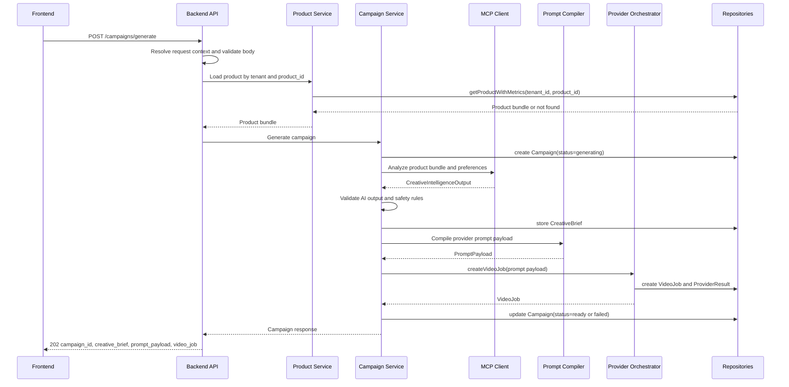

# Kastonom Backend System Plan

## Purpose

The Kastonom backend is the orchestration layer for the hackathon MVP. It exposes stable APIs to the frontend, enforces tenant boundaries, loads commerce data, calls the MCP / AI intelligence layer, compiles provider prompt payloads, creates video jobs, calls provider adapters, stores normalized results, and keeps a deterministic demo fallback path available.

The backend should make the demo feel complete without pretending the MVP is production infrastructure. The implementation should be boring, explicit, and easy to debug under hackathon pressure.

## Non-Negotiable Rules

- Frontend never calls AI video providers.
- Frontend never generates final video prompts.
- Backend never bypasses tenant scope.
- Backend never calls a live provider unless provider configuration is complete and mode allows live calls.
- Backend never fabricates product facts, prices, discounts, stock, guarantees, audience demographics, or provider state.
- Missing required configuration fails closed.
- Mock fallback is allowed only when configured and must be labeled as mock.
- Provider secrets come from environment variables only.
- Logs, fixtures, tests, provider results, and error responses must not include secrets.
- All AI and provider outputs are normalized before the frontend receives them.

## Recommended MVP Backend Shape

The repository currently contains documentation only. The implementation task may choose the final runtime, but this plan recommends a simple TypeScript backend because it gives strong contracts, easy JSON validation, and fast hackathon iteration.

Recommended stack:

- Runtime: Node.js with TypeScript.
- HTTP layer: Fastify or Express.
- Validation: Zod, Valibot, TypeBox, or a small local validator if dependency minimization is preferred.
- Tests: Vitest or Node test runner.
- Persistence for MVP: in-memory repositories seeded from JSON fixtures.
- Persistence upgrade path: SQLite or Postgres behind the same repository interfaces.

If a future scaffold chooses a different backend runtime, preserve the module boundaries and behavior in this plan.

## Backend Component Map

```text
Frontend
  -> HTTP API
    -> request context and tenant guard
      -> product service
      -> campaign service
        -> MCP client service
        -> AI output validator
        -> prompt compiler client
        -> provider orchestration service
          -> provider adapters
        -> video job service
      -> demo fallback service
      -> repositories
```

Backend modules:

- `server`: starts the process and binds HTTP routes.
- `app`: constructs the HTTP app without listening, for tests.
- `config`: reads environment variables, validates mode, and exposes safe configuration.
- `request-context`: resolves tenant id, request id, mode, and fallback eligibility.
- `errors`: maps domain errors into stable API responses.
- `repositories`: stores tenants, products, metrics, campaigns, creative briefs, video jobs, and provider results.
- `fixtures`: deterministic demo data and mock provider output.
- `product.service`: loads tenant-scoped products and metrics.
- `campaign.service`: coordinates the product-to-video-job flow.
- `mcp-client.service`: calls or mocks the MCP / AI intelligence layer.
- `ai-output.validator`: validates the MCP / AI response against the behavior contract.
- `prompt-compiler.service`: compiles creative briefs into normalized provider prompt payloads.
- `provider-orchestrator.service`: selects provider, checks config, applies fallback policy, and stores results.
- `provider-adapters`: `mock`, `pollo`, `kling`, `runway`.
- `video-job.service`: owns status transitions and polling responses.
- `demo-fallback.service`: returns deterministic demo state for `/demo/fallback`.

## Suggested File Layout

This is a planning target, not a required current file tree.

```text
backend/
  package.json
  tsconfig.json
  src/
    app.ts
    server.ts
    config/
      env.ts
      modes.ts
    http/
      routes/
        health.route.ts
        products.route.ts
        campaigns.route.ts
        video-jobs.route.ts
        demo.route.ts
      middleware/
        request-context.ts
        tenant-guard.ts
      errors/
        api-error.ts
        error-mapper.ts
    domain/
      ids.ts
      clock.ts
      types.ts
      validation.ts
    repositories/
      repository.types.ts
      memory-store.ts
      tenant.repository.ts
      product.repository.ts
      campaign.repository.ts
      video-job.repository.ts
      provider-result.repository.ts
    products/
      product.service.ts
      product.schemas.ts
    campaigns/
      campaign.service.ts
      campaign.schemas.ts
      campaign-state.ts
    mcp/
      mcp-client.service.ts
      ai-output.validator.ts
      mock-intelligence.ts
    prompt-compiler/
      prompt-compiler.service.ts
      prompt-payload.schemas.ts
    providers/
      provider.types.ts
      provider-orchestrator.service.ts
      adapters/
        mock-provider.adapter.ts
        pollo.adapter.ts
        kling.adapter.ts
        runway.adapter.ts
    video-jobs/
      video-job.service.ts
      video-job.schemas.ts
    demo/
      demo-fallback.service.ts
      demo-fixture.loader.ts
  fixtures/
    demo-tenant.json
    demo-products.json
    demo-metrics.json
    demo-audience-segments.json
    demo-provider-result.json
    demo-creative-brief.json
  tests/
    contract/
    unit/
    integration/
```

## Runtime Modes

The backend should make mode decisions explicit.

### `mock`

Default local and demo mode.

- Product source: demo fixtures.
- MCP / AI: deterministic mock intelligence or local rule-based implementation.
- Prompt compiler: real local compiler if implemented, otherwise deterministic mock compiler.
- Provider: mock provider.
- External network calls: none.
- Missing live provider credentials: irrelevant because live provider is not selected.

### `live`

Live provider mode.

- Product source may still be fixtures for MVP unless a later task adds live ERP.
- MCP / AI may be local deterministic logic or a configured model call if explicitly implemented.
- Provider calls are allowed only when selected provider config is complete.
- Missing provider credentials fail closed with `PROVIDER_CONFIG_MISSING`.
- Mock fallback is used only if `KASTONOM_FALLBACK_ENABLED=true` and the request or environment allows fallback.

### `degraded`

Response state, not necessarily a startup mode.

- Used by `/health` when optional dependencies are unavailable.
- Core API can still serve mock or cached demo data.
- Must not imply live provider readiness.

## Environment Configuration

Suggested environment variables:

```text
KASTONOM_MODE=mock | live
KASTONOM_FALLBACK_ENABLED=true | false
KASTONOM_DEMO_TENANT_ID=demo-tenant
KASTONOM_DEFAULT_PROVIDER=mock | pollo | kling | runway
KASTONOM_DEFAULT_LANGUAGE=Turkish
KASTONOM_DEFAULT_PLATFORM=tiktok
KASTONOM_DEFAULT_DURATION_SECONDS=15
KASTONOM_PUBLIC_BASE_URL=http://localhost:3000
KASTONOM_MOCK_PREVIEW_URL=/demo-assets/mock-ad-preview.mp4

POLLO_API_KEY=...
POLLO_API_BASE_URL=...
KLING_API_KEY=...
KLING_API_BASE_URL=...
RUNWAY_API_KEY=...
RUNWAY_API_BASE_URL=...
```

Configuration rules:

- Parse and validate config at startup.
- Do not crash on missing live provider credentials in `mock` mode.
- In `live` mode, do not call provider adapters until provider-specific config is validated.
- Treat empty strings as missing config.
- Never return config values or secrets through API responses.
- Surface safe config readiness through `/health`.

## Request Context and Tenant Scope

Every tenant-scoped endpoint resolves a request context before touching data.

Request context fields:

- `request_id`: generated per request for logs and errors.
- `tenant_id`: from `x-tenant-id`, or fixed demo tenant in demo mode.
- `mode`: resolved backend mode.
- `fallback_enabled`: resolved fallback policy.
- `requested_provider`: provider from request body or default provider.
- `is_demo_tenant`: true only for the configured demo tenant.

Rules:

- `GET /health` does not require tenant scope.
- `GET /demo/fallback` may use the fixed demo tenant only.
- `GET /products`, `POST /campaigns/generate`, and `GET /video-jobs/{id}` require tenant scope.
- If demo mode supplies a default tenant, API responses should still include data scoped to that tenant.
- Unknown tenant returns `INVALID_TENANT`.
- Missing tenant outside demo mode returns `INVALID_TENANT` or `UNAUTHORIZED`, depending on auth design chosen later.
- Data repositories always receive `tenant_id`.
- Repository methods must prefer compound lookups like `(tenant_id, id)`.

## Data Model Notes

The current `docs/contracts/data-model.contract.yaml` is the source of truth, but it has backend-relevant gaps to resolve before implementation:

- `Product.description` appears twice with conflicting `required` values.
- `ProductMetric` is referenced in relationships but is not defined as an entity.
- Product fields mention indexes on `category`, but `category` is not listed as a field.
- Metrics required by scoring, such as sales velocity and stock movement, need a concrete source shape.

Task `BE-000` exists to clean these contract gaps before code relies on the model.

Minimum backend entities for MVP:

- `Tenant`
- `Product`
- `ProductMetric`
- `AudienceSegment`
- `Campaign`
- `CreativeBrief`
- `PromptPayload`
- `VideoJob`
- `ProviderResult`

Recommended extra internal fields:

- `source`: `mock | erp | commerce | analytics | provider | unknown`
- `fallback_reason`: string or null
- `created_at`, `updated_at`
- `metadata`: object for adapter-specific or demo metadata

Use `unknown`, `not_available`, `null`, or explicit fallback notes when facts are missing.

## Product and Metric Loading

The product service should expose a stable product read model for the frontend.

Inputs:

- Tenant id.
- Optional pagination.
- Backend mode.
- Fallback policy.

Outputs:

- `products`
- `source`
- `fallback_reason`

Mock mode behavior:

- Load demo products and metrics from fixtures.
- Mark `source` as `mock`.
- Include explicit `fallback_reason` only when the endpoint had to recover from missing primary source.

Live mode behavior:

- If a live product source is not implemented, either fail closed or use documented mock fallback when allowed.
- Do not silently return mock products as live data.

## Campaign Generation Flow

`POST /campaigns/generate` is the central backend orchestration endpoint.

High-level sequence:



Detailed steps:

1. Validate request body.
2. Resolve provider default when omitted.
3. Resolve platform default when omitted.
4. Resolve language default when omitted.
5. Resolve duration default when omitted.
6. Load tenant-scoped product bundle.
7. If product missing, return `PRODUCT_NOT_FOUND`.
8. Create campaign record with `status=generating`.
9. Call MCP / AI intelligence layer with structured inputs only.
10. Validate MCP / AI output shape.
11. Run no-fabrication checks against product facts where feasible.
12. Store creative brief.
13. Compile provider prompt payload.
14. Create video job.
15. Call provider adapter or mock provider according to mode.
16. Store normalized provider result.
17. Update campaign status.
18. Return response with `202`.

## MCP / AI Client Contract

The backend should call the MCP / AI layer with structured data, not a free-form prompt.

Request shape should include:

- tenant context
- product facts
- product metrics
- audience segments
- campaign preferences
- brand constraints when available

Response validation should require:

- `product_id`
- `recommendation`
- `scores`
- `audience_summary`
- `creative_brief`
- `fallback_notes`

Safety validation:

- Product id in response must match requested product.
- Price claims must match product price or remain unknown.
- Discount claims must be absent unless discount data exists.
- Stock claims must match known stock data or remain unknown.
- Audience demographics must come from provided audience data.
- Forbidden claims must be preserved into the creative brief.
- Fallback notes must remain visible.

Invalid MCP / AI output behavior:

- Reject with `AI_OUTPUT_INVALID`.
- Do not continue to prompt compilation.
- Optionally return deterministic mock intelligence only when demo fallback mode explicitly allows it.

## Prompt Compiler Integration

The backend calls the prompt compiler after creative brief validation.

Rules:

- The prompt compiler does not recommend products.
- The prompt compiler does not call provider APIs.
- The prompt compiler output must include `provider`, `prompt_text`, `negative_prompt`, `duration_seconds`, `aspect_ratio`, `language`, `metadata`, `is_mock`, and `fallback_notes`.
- Provider-specific options live under `metadata.provider_options`.
- Negative instructions and forbidden claims are never dropped.
- Unsupported provider returns a clear error unless mock fallback is allowed.

The backend stores prompt payload metadata with the campaign or video job so the demo can show the generated artifact if needed.

## Provider Adapter Strategy

All provider calls go through a common interface.

Provider adapter input:

- `tenant_id`
- `campaign_id`
- `video_job_id`
- normalized prompt payload
- duration
- aspect ratio
- language
- safe provider config

Provider adapter output:

- `provider`
- `provider_job_id`
- `raw_status`
- `normalized_status`
- `result_url`
- `error_code`
- `error_message`
- `received_at`
- `metadata`

Supported adapters:

- `MockProviderAdapter`
- `PolloProviderAdapter`
- `KlingProviderAdapter`
- `RunwayProviderAdapter`

Mock provider behavior:

- Requires no external credentials.
- Returns deterministic statuses.
- Marks every result as mock.
- Uses a configured local or public demo preview URL.
- Returns explicit failure if the mock preview asset is missing and no safe placeholder is configured.

Live provider behavior:

- Validate provider config before creating a live submission.
- Do not perform network calls in tests unless explicitly enabled.
- Normalize provider errors.
- Store raw status only when it does not contain secrets.
- Do not expose provider-specific secrets or internal request details to frontend.

## Video Job Lifecycle

Allowed statuses:

- `queued`
- `processing`
- `completed`
- `failed`

MVP state transitions:

```text
queued -> processing -> completed
queued -> processing -> failed
queued -> failed
```

Mock mode can complete immediately or simulate a deterministic two-step progression.

Recommended mock progression:

- Creation response: `queued` or `completed`, depending on frontend needs.
- First poll: `processing`.
- Second poll: `completed`.

For the fastest hackathon demo, immediate `completed` is acceptable if the UI can still show status fields.

Rules:

- `GET /video-jobs/{id}` always uses `(tenant_id, id)`.
- Unknown job id returns `VIDEO_JOB_NOT_FOUND`.
- Cross-tenant job access also returns `VIDEO_JOB_NOT_FOUND` or `403` without leaking that the job exists.
- Failed jobs include a normalized error object.
- Completed mock jobs include `is_mock=true`.

## API Endpoint Design

The source API contract is `docs/contracts/api.contract.yaml`. Implementation should keep that contract stable.

### `GET /health`

Purpose:

- Verify backend process is running.
- Expose safe mode and readiness information.

Success body:

- `status`
- `mode`
- `version`
- optional safe readiness flags

Do not include:

- Provider API keys.
- Full environment variables.
- Tenant data.

### `GET /products`

Purpose:

- Return tenant-scoped products with metrics for the creative console.

Required behavior:

- Resolve tenant.
- Load products from repository or demo fixture.
- Return `source`.
- Return `fallback_reason` when fallback path is used.
- Do not invent products when both primary and fallback sources are unavailable.

### `POST /campaigns/generate`

Purpose:

- Generate product intelligence, creative brief, prompt payload, and video job.

Required behavior:

- Validate body.
- Enforce tenant scope.
- Load product.
- Call MCP / AI.
- Validate AI output.
- Compile prompt payload.
- Create video job.
- Call provider adapter or mock provider.
- Return `202`.

### `GET /video-jobs/{id}`

Purpose:

- Allow frontend polling of job state.

Required behavior:

- Resolve tenant.
- Load job by `(tenant_id, id)`.
- Return normalized job state.
- Never expose cross-tenant jobs.

### `GET /demo/fallback`

Purpose:

- Return deterministic demo data for a full fallback path.

Required behavior:

- Load demo products, sample campaign, sample creative brief, and sample video job.
- Mark result as demo/mock.
- Return explicit error if required demo fixtures or preview assets are missing.

## Error Model

Use stable error codes and short human-readable messages.

Recommended internal error shape:

```json
{
  "code": "PRODUCT_NOT_FOUND",
  "message": "Product was not found for this tenant.",
  "status": 404,
  "details": {},
  "request_id": "req_..."
}
```

Do not include:

- Provider secrets.
- Raw provider request bodies that may contain credentials.
- Stack traces in production responses.
- Data from a different tenant.

Important API errors:

- `INVALID_REQUEST`
- `UNAUTHORIZED`
- `INVALID_TENANT`
- `PRODUCT_SOURCE_UNAVAILABLE`
- `INVALID_PRODUCT_ID`
- `PRODUCT_NOT_FOUND`
- `AI_OUTPUT_INVALID`
- `PROVIDER_CONFIG_MISSING`
- `PROVIDER_UNAVAILABLE`
- `VIDEO_JOB_NOT_FOUND`
- `DEMO_FALLBACK_UNAVAILABLE`
- `CONFIGURATION_MISSING`
- `INTERNAL_ERROR`

## Failure Matrix

| Situation | Backend behavior | Frontend visible behavior |
| --- | --- | --- |
| Missing tenant outside demo mode | Fail closed with tenant/auth error | Show actionable auth or tenant error |
| Unknown tenant | Return `INVALID_TENANT` | No data shown |
| Product source unavailable and fallback disabled | Return `PRODUCT_SOURCE_UNAVAILABLE` | Product load failure |
| Product source unavailable and fallback enabled | Return mock products with fallback label | Demo products shown as mock |
| Product id not found | Return `PRODUCT_NOT_FOUND` | Product-specific error |
| MCP output invalid | Return `AI_OUTPUT_INVALID` | Campaign generation failed |
| MCP unavailable and fallback disabled | Fail closed | Error state |
| MCP unavailable and fallback enabled | Use deterministic mock intelligence with fallback note | Brief labeled with fallback note |
| Prompt compiler unsupported provider | Fail unless mock fallback allowed | Provider error or fallback state |
| Live provider config missing | Return `PROVIDER_CONFIG_MISSING` | Explain live provider not configured |
| Live provider fails and fallback disabled | Store failed job and normalized error | Failed job state |
| Live provider fails and fallback enabled | Store fallback reason and mock job | Mock preview with fallback label |
| Mock preview asset missing | Return `DEMO_FALLBACK_UNAVAILABLE` or failed mock job | Explicit missing asset error |

## Persistence Plan

For MVP, use repositories over an in-memory store seeded from JSON fixtures.

Why:

- Fast to implement.
- Deterministic for tests.
- No migration risk during hackathon.
- Easy to replace with SQLite or Postgres later.

Repository requirements:

- Every tenant-scoped lookup takes `tenant_id`.
- Id generation is injectable for tests.
- Clock is injectable for tests.
- Stores can reset between tests.
- Provider results can be replayed from stored normalized records.
- Mock fixtures are clearly labeled.

Entities to store:

- tenants
- products
- product metrics
- audience segments
- campaigns
- creative briefs
- prompt payload metadata
- video jobs
- provider results

## Validation Plan

Validation happens at boundaries:

- Environment variables at startup.
- Request headers and bodies at HTTP entry.
- Repository inputs at service boundary.
- MCP / AI output before prompt compilation.
- Creative brief before prompt compilation.
- Prompt payload before provider adapter calls.
- Provider result before storage.
- API response shape in integration tests.

Validation should prefer explicit errors over silent coercion.

## Security and Privacy Plan

MVP security is scoped but still strict.

Rules:

- No secrets in code.
- No secrets in fixtures.
- No secrets in tests.
- No secrets in logs.
- No provider keys in frontend responses.
- Tenant id must be present or resolved from demo mode.
- Cross-tenant reads must not leak existence.
- Raw provider responses are stored only after secret redaction.
- Demo data must be obviously mock or fixture based.

## Logging and Observability

Use structured logs if the selected runtime supports it.

Safe fields:

- request id
- route
- method
- status code
- tenant id hash or demo tenant id
- provider name
- job id
- campaign id
- duration in milliseconds
- error code

Unsafe fields:

- API keys
- authorization headers
- full environment variables
- raw provider credentials
- unredacted provider request payloads
- user PII, if later introduced

Minimum logs for demo:

- request started and completed
- campaign generation started and completed
- provider fallback used
- provider error normalized

## Test Strategy

Backend implementation should include contract-focused tests.

### Unit Tests

- Config parsing.
- Tenant context resolution.
- Product repository tenant filtering.
- Product service fallback behavior.
- Campaign state transitions.
- MCP output validation.
- No-fabrication validators.
- Prompt compiler handoff.
- Provider config validation.
- Mock provider deterministic output.
- Video job status transitions.

### Integration Tests

- `GET /health` returns safe mode.
- `GET /products` returns demo products in mock mode.
- `GET /products` fails closed when product source unavailable and fallback disabled.
- `POST /campaigns/generate` completes through mock provider.
- `POST /campaigns/generate` fails on invalid product id.
- `POST /campaigns/generate` fails closed for live provider with missing credentials.
- `GET /video-jobs/{id}` returns tenant-scoped job.
- `GET /video-jobs/{id}` does not leak cross-tenant job.
- `GET /demo/fallback` returns deterministic fallback payload.

### Contract Tests

- API response fields match `docs/contracts/api.contract.yaml`.
- Data model fixtures match `docs/contracts/data-model.contract.yaml`.
- Creative brief matches `docs/prompts/creative-brief.template.yaml`.
- MCP output matches `docs/contracts/ai-behavior.contract.yaml`.

### Static Checks

- Frontend source must not import provider SDKs.
- Frontend source must not contain final prompt compiler logic.
- Backend source must not contain hardcoded provider secrets.
- Fixtures must not contain API keys.

## Implementation Phases

### Phase 0: Contract cleanup

Resolve backend-blocking contract gaps before writing code:

- Product field duplication.
- Missing `ProductMetric` entity.
- Missing `category` field.
- Metric fields for scoring.
- Prompt payload storage shape.

### Phase 1: Backend skeleton

Create backend runtime, app construction, health route, config parser, error mapper, and test harness.

### Phase 2: Data and tenant foundation

Add demo fixtures, repositories, tenant guard, product service, and `/products`.

### Phase 3: Campaign orchestration without live providers

Add campaign service, deterministic MCP mock or client boundary, AI output validator, prompt compiler integration, mock provider, video job service, and `/campaigns/generate`.

### Phase 4: Polling and fallback

Add `/video-jobs/{id}`, `/demo/fallback`, normalized provider result storage, and frontend-friendly fallback states.

### Phase 5: Live provider readiness

Add live provider adapter skeletons that fail closed until each provider is explicitly configured and tested.

### Phase 6: Hardening

Add contract tests, no-secret checks, cross-tenant tests, and demo run instructions.

## Demo Readiness Definition

The backend is demo-ready when:

- The server starts locally in mock mode.
- `/health` reports mode safely.
- `/products` returns demo products.
- `/campaigns/generate` creates a campaign, creative brief, prompt payload, video job, and provider result.
- `/video-jobs/{id}` returns a completed or progressing mock job.
- `/demo/fallback` returns deterministic full-flow data.
- Mock state is labeled.
- Missing live config fails closed.
- Tests cover the main mock path and at least one fail-closed path.

