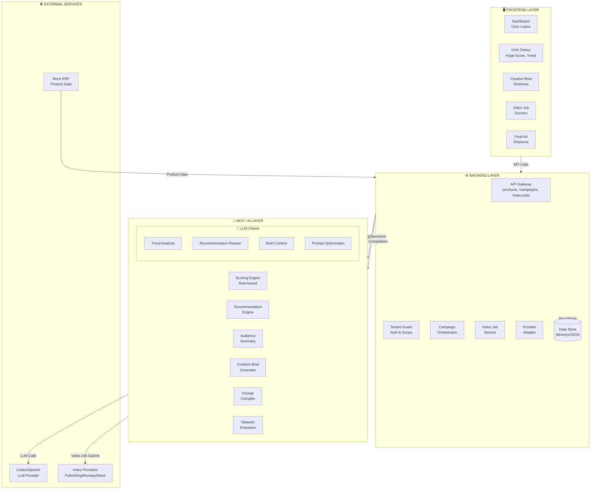
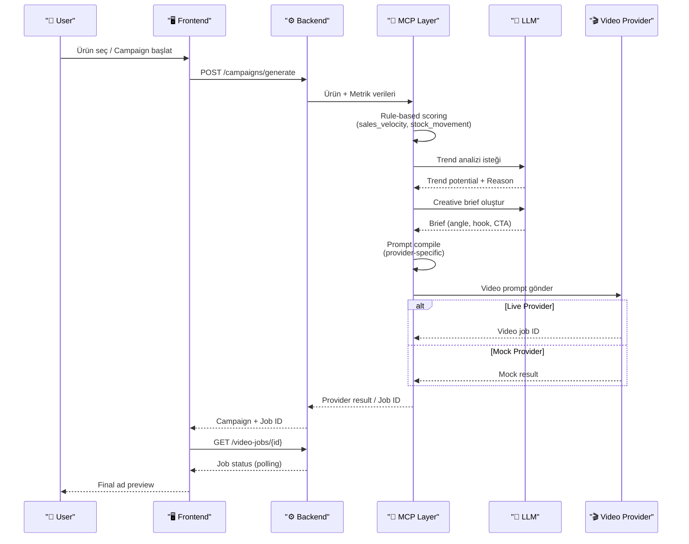
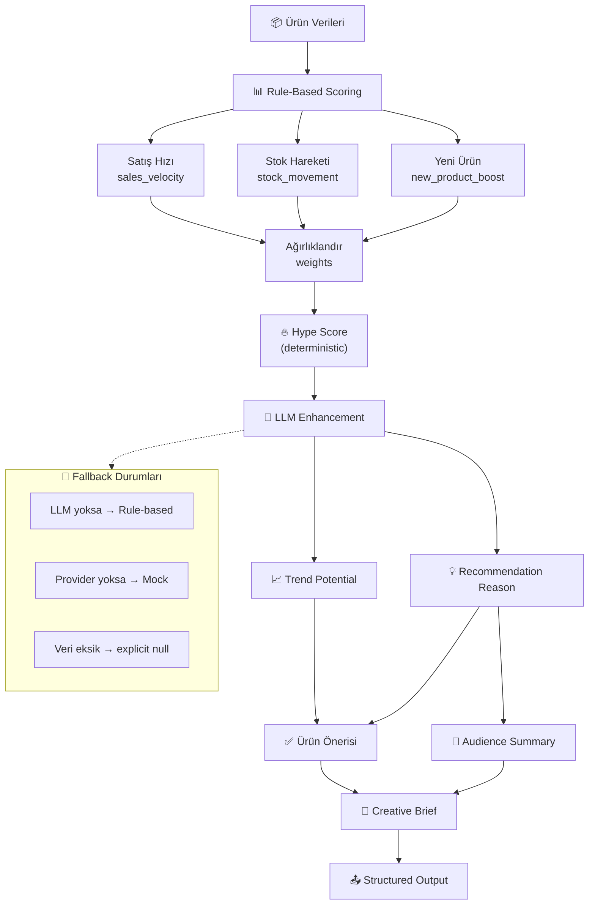
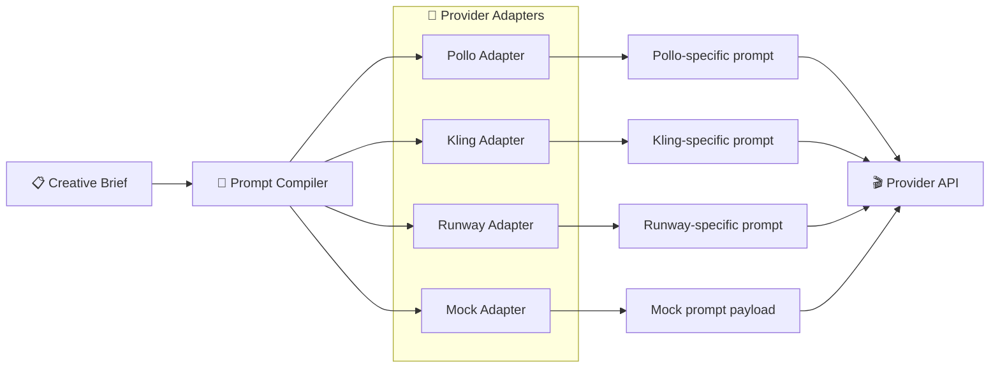
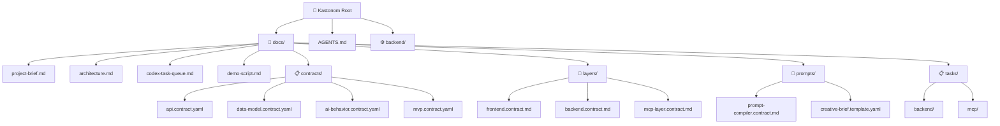
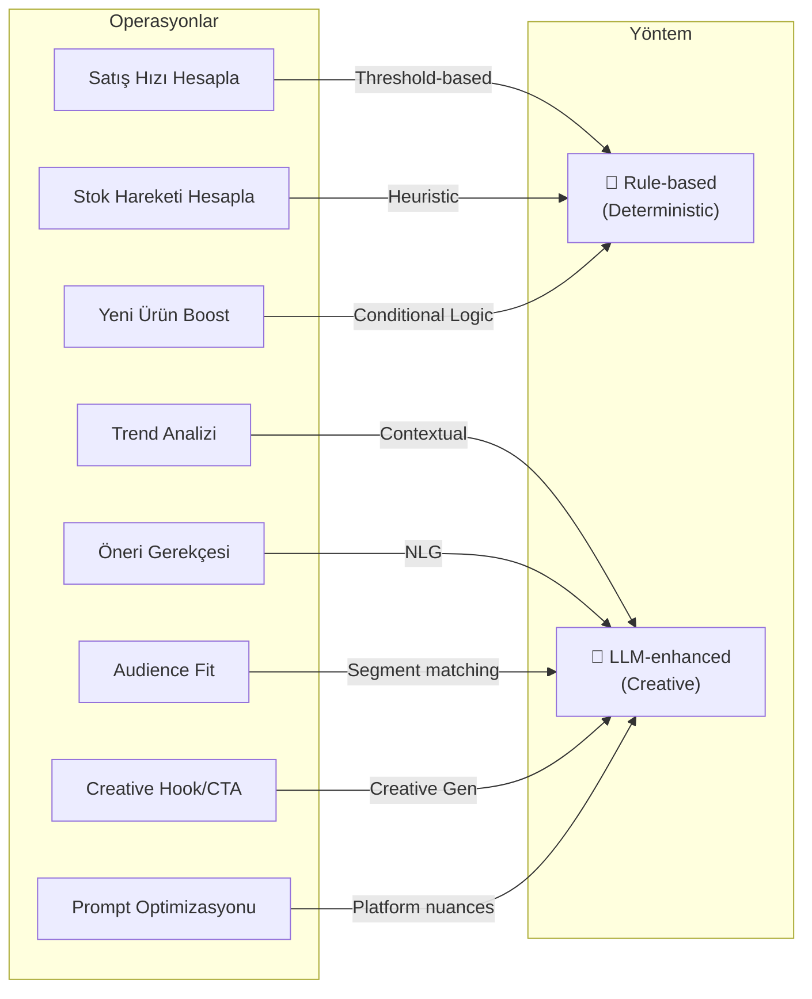
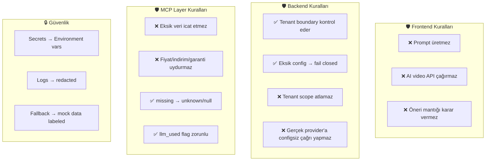

# Kastonom System Flow Diagram

> **Not:** Bu diagram Mermaid formatında yazılmıştır. GitHub, VS Code (Mermaid extension), Miro, Excalidraw veya mermaid.live adresinde görselleştirilebilir.

---

## 1. Üç Katmanlı Mimari

---

## 2. Ana Veri Akışı

---

## 3. MVP Demo Akışı (3 dakika)

```mermaid
flowchart LR
    subgraph Step1["0:00-0:30"]
        A1["Kastonom Nedir?"]
        A2["Üç katman göster"]
    end

    subgraph Step2["0:30-1:10"]
        B1["Dashboard aç"]
        B2["Ürün listesi göster"]
        B3["Hype score göster"]
        B4["Önerilen ürünü vurgula"]
    end

    subgraph Step3["1:10-1:50"]
        C1["Ürün detayına git"]
        C2["Audience summary göster"]
        C3["Creative angle göster"]
        C4["Brief önizlemesi"]
    end

    subgraph Step4["1:50-2:30"]
        D1["Campaign başlat"]
        D2["Video job durumu göster"]
        D3["Fallback açıkla (opsiyonel)"]
    end

    subgraph Step5["2:30-3:00"]
        E1["Final ad göster"]
        E2["Değer özeti"]
    end

    Step1 --> Step2 --> Step3 --> Step4 --> Step5
```

---

## 4. Ürün Skorlama Akışı

---

## 5. Prompt Derleme Akışı

---

## 6. Klasör Yapısı Akışı

---

## 7. LLM Kullanım Matrisi

---

## 8. Güvenlik Sınırları

---

## Görselleştirme Araçları

### GitHub / GitLab
Dosyayı raw olarak görüntüleyin - Mermaid otomatik render eder.

### VS Code
[Mermaid extension](https://marketplace.visualstudio.com/items?itemName=bierner.markdown-mermaid) yükleyin.

### Online
[mermaid.live](https://mermaid.live) → Paste this file content

### Whiteboard
[Miro](https://miro.com), [Excalidraw](https://excalidraw.com) → Import/Export ile Mermaid kullanın.